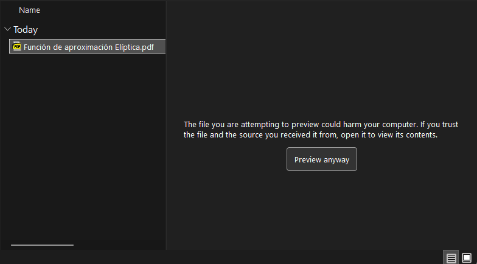
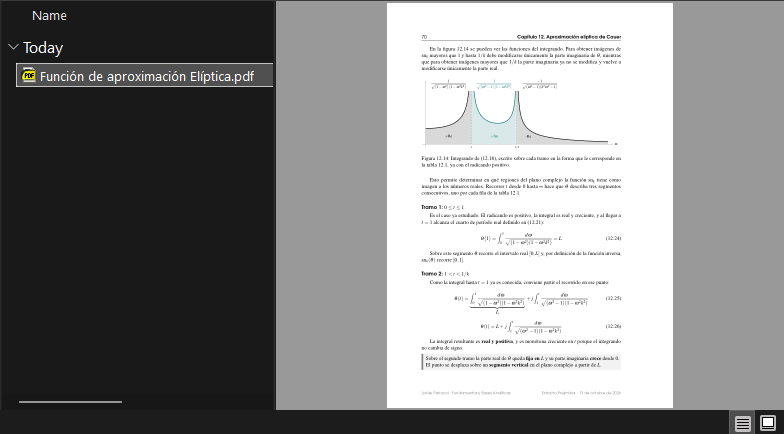

# Enable Preview Pane for Downloaded Files

A [Windhawk](https://windhawk.net/) mod that lets the File Explorer preview pane show selected file types (PDF by default) that are marked as downloaded from the Internet, without removing the mark.

| Without the mod | With the mod |
|---|---|
|  |  |

Since the October 2025 Windows updates, File Explorer refuses to preview files that have the Mark of the Web (`Zone.Identifier`): "The file you are attempting to preview could harm your computer." This mod hooks the preview check in `explorer.exe` and allows it only for the extensions you choose, only for files on local drives in the Internet zone. The `Zone.Identifier` stream is not touched, so SmartScreen, Office Protected View and other checks behave as before.

Read the README block at the top of [`enable-preview-pane-for-downloads.wh.cpp`](enable-preview-pane-for-downloads.wh.cpp) before enabling it. It explains the checks, the settings, the types that are never exempted and the risk of turning off this protection.

## Install

The mod has been submitted to the Windhawk catalog: [ramensoftware/windhawk-mods#7819](https://github.com/ramensoftware/windhawk-mods/pull/7819). Once it is accepted, install it from Windhawk.

Until then: in Windhawk, *Create a new mod*, paste the source of [`enable-preview-pane-for-downloads.wh.cpp`](enable-preview-pane-for-downloads.wh.cpp), *Compile*, *Enable*.

## Testing

[`tools/Test-PreviewHandlers.ps1`](tools/Test-PreviewHandlers.ps1) checks, for each registered PDF preview handler, whether the preview pane shows a PDF that has the Mark of the Web, and saves a screenshot of each result. Run it from a normal PowerShell window with the preview pane turned on. It restarts File Explorer several times and restores the original preview handler at the end. See the help at the top of the script for details.

## License

[MIT](LICENSE)
